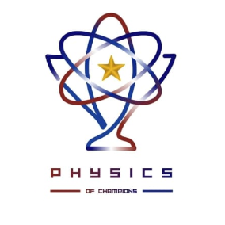

# 🏆 Physics of Champions - Kubus Soal 3D & Realtime Leaderboard

Aplikasi web interaktif display panggung kompetisi fisika dengan kubus 3D melayang real-time yang memuat 20 soal fisika, logo resmi kompetisi di sisi atas dan bawah, serta panel klasemen realtime 17 peserta dengan animasi pergeseran ranking GSAP FLIP.



---

## ✨ Fitur Utama

- **Kubus 3D Melayang & Berotasi Halus (Ultra-Smooth CSS 3D)**:
  - Rotasi horizontal dan ayunan elevasi vertikal harmonik yang tenang dan sinematik.
  - Sisi kubus solid 100% *opaque* anti-tembus (*anti-bleed*) dengan pencahayaan neon ambient.
  - Interaksi drag & swipe 3D dengan inersia lembut, serta pause/resume via tombol Space atau *double click*.
- **Distribusi 20 Soal Fisika**:
  - 4 sisi vertikal (Depan, Kanan, Belakang, Kiri) memuat masing-masing 5 soal fisika (Total 20 soal).
  - Tipografi Sans-Serif tebal dan kontras tinggi, terkalibrasi pas tanpa tumpah/overflow ke bawah.
- **Logo Resmi di Sisi Atas & Bawah**:
  - Menampilkan emblem melingkar resmi *Physics of Champions* lengkap dengan animasi cincin orbit ganda dan badge judul.
- **Klasemen Realtime (17 Peserta)**:
  - Dilengkapi foto avatar karakter resmi (boy & girl) yang tampil utuh dan presisi di tengah lingkaran.
  - Tombol penambahan nilai `+ 1` poin instan dengan efek suara chime Web Audio API sintetis.
  - **Animasi Kenaikan Posisi 2 Detik (GSAP FLIP)**: Baris peserta yang naik peringkat diangkat ke layer depan dengan sorotan hijau emerald, scale pop, dan partikel melayang `✨ +1`.
- **Mode Layar Penuh (Fullscreen)**:
  - Tombol Fullscreen di pojok kiri atas yang otomatis tersembunyi saat mode layar penuh aktif untuk tampilan panggung yang imersif dan bersih.

---

## 🛠️ Teknologi yang Digunakan

- **HTML5 & Semantic Structure**
- **CSS3 3D Transforms** (`preserve-3d`, `backface-visibility`, CSS variables, keyframe animations)
- **Modern JavaScript (ES6+)**
- **GSAP 3 & Flip Plugin** (Smooth rank climbing & FLIP layout transitions)
- **Web Audio API** (Procedural synthesizer harmonic sound effects)

---

## 🚀 Cara Menjalankan

Aplikasi ini berbasis web murni tanpa build step yang rumit. Cukup jalankan server lokal sederhana:

### Menggunakan Python:
```bash
python -m http.server 5173
```
Buka browser di [http://localhost:5173](http://localhost:5173).

### Menggunakan Node.js / npx:
```bash
npx serve .
```

---

## 👥 Data Peserta
1. Agnia Rahman
2. Andi Alda
3. Abdurrahman
4. Putri Siti Nurhayati
5. Ryan Prasetya
6. Wilda Fathani Salsabila
7. Alifia Novi Earlydani
8. Hilmi Aminuddin
9. Salsabila
10. Fitri Ramadhani
11. Erika Haryanto
12. Irsad
13. Putri Alika
14. Salma Okta
15. Agung
16. Arven
17. Rivan

---

© 2026 Physics of Champions. All Rights Reserved.
